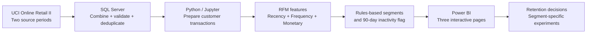

  <h2>RetentionIQ — Customer Value, RFM Segmentation and Churn Risk Analytics</h2> <h3>Turn retail transactions into smarter customer-retention decisions.</h3>
  
End-to-end data cleaning, customer segmentation, revenue analysis, and interactive business intelligence.
  

    
    
    
    
  
  

    <a href="#-dashboard-gallery">📸 Dashboard</a> &nbsp;•&nbsp;
    <a href="#-business-findings">💡 Findings</a> &nbsp;•&nbsp;
    <a href="#-analytical-workflow">⚙️ Workflow</a> &nbsp;•&nbsp;
    <a href="#-how-to-run">🚀 Run locally</a>
  

📌 Project at a glance
<table>
  <tr>
    <td align="center" width="25%"><b>5,881</b> Unique customers</td>
    <td align="center" width="25%"><b>£17.37M</b> Historical sales</td>
    <td align="center" width="25%"><b>50.86%</b> 90-day inactivity rate</td>
    <td align="center" width="25%"><b>779,495</b> Analyzed line items</td>
  </tr>
</table>The business challenge: Which customers are driving revenue, which have become inactive, and where should a retailer focus its retention efforts?

My solution: Build a customer-level RFM model and a three-page Power BI experience, connecting transactional data quality to actionable retention segments.

Industry: UK online giftware / e-commerce retail   |   Time period: Dec 2009 – Dec 2011   |   Dataset: UCI Online Retail II
📸 Dashboard gallery
All three images below are from the actual Power BI dashboard, not generated mock-ups.
01 · Customer Insights — Executive landing page

  

Executive KPI summary, report navigation and plain-English definitions of churn, recency, frequency and customer value.
02 · Business Overview   /   03 · RFM Analysis
<table>
  <tr>
    <td width="50%" align="center">
      
       <b>Business Overview</b> 
      Revenue by segment • Revenue by inactivity status • Monthly, quarterly and yearly trends • Six slicers
    </td>
    <td width="50%" align="center">
      
       <b>RFM Analysis</b> 
      Segment performance • Average customer value • R/F/M scores • Inactivity-status trend views
    </td>
  </tr>
</table>Dashboard controls: Month · Quarter · Year · Country · Segment · Is Churned

⚠️ The supplied screenshots display $ currency formatting, but the underlying UCI retailer records are in GBP (£). Update the Power BI formatting before publishing a final refreshed dashboard. The screenshots above are preserved as provided.
💡 Business findings
<table>
  <thead><tr><th>Finding</th><th>Verified evidence</th><th>Business meaning</th></tr></thead>
  <tbody>
    <tr><td><b>Revenue is highly concentrated</b></td><td>1,334 Champions (22.68% of customers) generate <b>68.56%</b> of historical sales.</td><td>Protect high-value relationships rather than using universal discounts.</td></tr>
    <tr><td><b>Inactivity is widespread</b></td><td><b>2,991 of 5,881</b> customers meet the 90-day inactivity rule.</td><td>Segment retention outreach by value and engagement.</td></tr>
    <tr><td><b>At Risk is a clear test group</b></td><td><b>481</b> At Risk customers have <b>£1.09M</b> in past sales.</td><td>Test targeted win-back messaging with a holdout group.</td></tr>
    <tr><td><b>Some Loyal customers disengaged</b></td><td><b>420 of 1,494</b> Loyal customers are inactive (28.11%).</td><td>Consider personalized outreach based on past purchase behavior.</td></tr>
    <tr><td><b>The UK dominates sales</b></td><td><b>82.82%</b> of historical sales are attributed to the United Kingdom.</td><td>Start controlled CRM experiments in the largest observed market.</td></tr>
  </tbody>
</table>Customer segmentation results
RFM segment	Customers	Inactive customers	90-day inactive %	Historical revenue	Revenue share
Champions	1,334	0	0.00%	£11,912,053.86	68.56%
Loyal	1,494	420	28.11%	£2,723,820.81	15.68%
At Risk	481	481	100.00%	£1,089,483.96	6.27%
Lost	1,864	1,864	100.00%	£1,150,759.83	6.62%
New	326	0	0.00%	£298,980.66	1.72%
Need Attension*	382	226	59.16%	£199,705.13	1.15%

*`Need Attension` is the exact label in the supplied notebook/report; the intended spelling is “Needs Attention.” Segment rules depend partly on recency, so these associations are descriptive, not proof of a causal churn driver.
🎯 Business recommendations
Priority	Target segment	Proposed action	Measure success by
Protect value	Champions	VIP service and proactive account management	Retained repeat purchases and margin
Win back	At Risk + inactive Loyal	Personalized reactivation campaign with an untreated control group	Incremental orders and contribution profit
Build habits	New	Timely second-purchase prompts	Second-purchase conversion rate
Control spending	Lost / Need Attension	Low-cost reactivation tests; suppress persistent nonresponders	Cost per incremental reactivation

Profitability check: Incremental contribution = incremental orders × contribution margin per order − incentive cost − campaign/servicing cost
Realized profit uplift: [Insert Exact Metric] · Campaign cost: [Insert Exact Metric] · Contribution margin: [Insert Exact Metric].
These inputs were not provided; no unmeasured ROI or revenue savings are claimed.

⚙️ Analytical workflow

1 · SQL Server — clean and validate
- Combine source periods with UNION ALL and normalize date/price fields with TRY_CONVERT.
- Audit missing IDs, invalid quantities, date casts, missing descriptions, and duplicates.
- Use ROW_NUMBER() OVER (PARTITION BY ...) to retain the first occurrence of exact duplicate transaction lines.
Pipeline checkpoint	Line items
Raw records	1,067,371
After deduplication / intermediate export	1,033,036
With known customer ID	797,885
Positive quantity + known customer ID	779,495

SQL implementation: [`sql/Data-Cleaning-BySql.sql`](sql/Data-Cleaning-BySql.sql)
2 · Python — customer-level RFM and inactivity
Feature	How it is measured
Recency (R)	Days since the customer's last recorded purchase
Frequency (F)	Number of distinct invoices
Monetary (M)	Total historical Quantity × Price
Inactivity / churn flag	Recency > 90 days, evaluated as of 10 Dec 2011

Customers receive quantile-based R, F and M scores and are assigned to six rule-based segments. These customer features are joined back onto invoice line items for Power BI.

Python implementation: [`notebooks/New_Segments_Added.ipynb`](notebooks/New_Segments_Added.ipynb)
3 · Power BI — dashboards for stakeholders
- Customer Insights: four headline KPIs and page navigation.
- Business Overview: revenue concentration, sales trends and churn-status split.
- RFM Analysis: segment performance, customer value and churn-status trend charts.
- Use distinct customer counting for customer KPIs—do not count invoice lines as customers.
Power BI report: [`powerbi/Churn Dashboard.pbix`](powerbi/Churn%20Dashboard.pbix)
🧰 Tech stack
Layer	Tools	Role in this project
Data ingestion and cleaning	Microsoft SQL Server / T-SQL	Combine periods, validate records, remove duplicates
Feature engineering	Python, pandas, NumPy, Jupyter	Recency, frequency, monetary scores and customer segments
Business intelligence	Power BI	KPI cards, slicers, trend and segment visualizations
Data exchange	CSV / Excel	Transfer cleaned output to the BI model

📁 Repository structure
RetentionIQ-Customer-Retention-Analytics/
├── README.md
├── assets/
│   ├── retentioniq_banner.svg
│   ├── dashboard_overview.png
│   ├── business_overview.png
│   └── rfm_analysis.png
├── sql/
│   └── Data-Cleaning-BySql.sql
├── notebooks/
│   └── New_Segments_Added.ipynb
├── powerbi/
│   └── Churn Dashboard.pbix
└── data/                       # optional local, not published
    ├── raw/
    └── processed/
The source transactions and generated Excel workbook are large and should be downloaded/regenerated locally, rather than checked into this repository. The source BRD was marked Internal Use Only and is intentionally excluded from this public layout.
🚀 How to run
Prerequisites: Python 3.x, Microsoft SQL Server/SSMS, Power BI Desktop, and the UCI Online Retail II dataset.
1. Prepare SQL inputs. Import both source periods to SQL Server with the columns expected by [`sql/Data-Cleaning-BySql.sql`](sql/Data-Cleaning-BySql.sql). Run the SQL sections in order, validating quality checks and the dbo.RetailCleaned result.
2. Export full timestamps. Save dbo.RetailCleaned as a headerless nine-column CSV (including the SourceSheet field), preserving complete InvoiceDate values such as 2011-12-09 12:50:00.
3. Install dependencies. In your local project folder, run:
   python -m venv .venv
   # Windows PowerShell: .venv\Scripts\Activate.ps1
   # macOS/Linux: source .venv/bin/activate
   pip install pandas numpy openpyxl jupyter
   jupyter notebook
4. Run RFM. Open [`notebooks/New_Segments_Added.ipynb`](notebooks/New_Segments_Added.ipynb), set the input CSV and output Excel file paths for your machine, then execute the cells.
5. Open the dashboard. Open [`powerbi/Churn Dashboard.pbix`](powerbi/Churn%20Dashboard.pbix) in Power BI Desktop, repoint the workbook data source, refresh, and validate the KPI measures and filters.
Reproducibility note: The intermediate CSV supplied in the original project archive has damaged invoice timestamps (time-like strings instead of full dates). Re-export the cleaned records from SQL; do not use that CSV unchanged.

🔎 Metric interpretation & limitations
- Not a predictive churn model. This project uses RFM rules and a 90-day inactivity flag, not a trained ML classifier.
- One fixed snapshot. IsChurned is determined as of 10 Dec 2011; the report's “churn by month/quarter/year” visuals group this final flag over historical transaction dates. They are not independently recalculated period-specific churn rates.
- Historic sales ≠ lost future revenue. Past revenue from inactive customers measures historic value, not forecast recoverable sales.
- No causal drivers or tested ROI. Pricing, campaign exposures, customer support, acquisition costs and contribution margin are not present in the source data.
- Additional QA: Validate the SourceSheet year labeling, zero-price line treatment, DAX measure definitions and slicer cross-filtering before publishing refreshed figures.
🗺️ Next improvements
- [ ] Validate customer-grain KPI DAX and page filter interactions.
- [ ] Correct report currency formatting to GBP.
- [ ] Add true rolling monthly / cohort-based churn metrics.
- [ ] Test segment-specific retention interventions with holdout groups.
- [ ] Evaluate an optional predictive churn classifier on time-separated data.

  <h3>From historical transactions → meaningful customer segments → measurable retention decisions</h3>
  Data attribution: Chen, D. (2012), <a href="https://archive.ics.uci.edu/dataset/502/online+retail+ii">Online Retail II</a>, UCI Machine Learning Repository · <a href="https://doi.org/10.24432/C5CG6D">DOI: 10.24432/C5CG6D</a>

